# SlipNope — overpay? nope.

**Live app:** https://slipnope.vercel.app · **Demo video:** [`demo/slipnope-demo.mp4`](demo/slipnope-demo.mp4) (118s) · **Chain:** Base (mainnet 8453 · Sepolia 84532) · **Season:** Base Stocks Maxxing — Programmable Stock Markets · **Submission pack:** [`docs/SUBMISSION.md`](docs/SUBMISSION.md)

> Tokenized stocks trade 24/7. The stock market doesn't. In the gap, thin books drift far from fair value — and every wallet lets you click buy anyway. SlipNope is a Uniswap v4 hook that stands *inside* your swap: it reads the Chainlink fair price mid-transaction and **reverts the trade if you would overpay**. Dashboards warn. Pools enforce.

---

## 1. Product

### What it is

SlipNope ports the FairBuy execution-safety thesis ("never overpay for tokenized stocks") to the first place it can live **in the market itself**: a Uniswap v4 `beforeSwap` hook on Base, where every Coinbase tokenized stock ships with a Chainlink fair-price feed a hook can read atomically.

For every swap in a guarded pool the hook computes the direction-aware adverse deviation between pool price and Chainlink fair value:

| Tier | Condition | Result |
|---|---|---|
| **OK** | adverse ≤ band/2 | swap executes, 0.05% LP fee |
| **WARN** | adverse ≤ band | swap executes, fee scales with deviation (cap 1%) |
| **BLOCK** | adverse > band | **swap reverts** (`OverpayBlocked`) — it cannot execute |
| **POST-SWAP** | a single swap would leave the pool > band from fair | **swap reverts** (`PostSwapOutOfBand`) — one trade cannot dislocate the book |
| **FAIL-CLOSED** | stale / invalid reference | **swap reverts** — the guard never guesses |

Universal band: ±3.00%.

### Who it is for

Base traders buying tokenized stocks (NVDAc first) in thin 24/7 pools while the underlying market sleeps.

### The problem (evidence)

- Coinbase's Base docs describe the gap structurally: Chainlink equity feeds run 24/5 and freeze off-hours by design; "never settle or liquidate against a frozen feed."
- DEX pools on Base trade into those frozen refs — the last session's price stays in the feed while the pool keeps moving. Somebody is about to overpay, on every thin pool, every night.
- Existing products display prices or execute blindly. Nobody enforces at execution time — because on most chains they can't. On Base + Uniswap v4, a hook can.

### Why now

Coinbase tokenized stocks (B20, 298 listed) + Chainlink 24/5 total-return feeds went live on Base (Aug 2026); Uniswap v4 is deployed on Base mainnet; 0x feed proxies are live on mainnet today. SlipNope was fork-tested against live Base state on Nov 9 2026.

### Innovation

Fair-price protection used to require trusting an app to warn you before you signed elsewhere. SlipNope moves the check **inside execution**:

- `beforeSwap` reads Chainlink, computes adverse deviation from the live pool sqrt price, and the swap either executes in-band at a fair fee, pays a deviation-scaled WARN fee, or **cannot execute at all**.
- `afterSwap` re-checks the resulting price: if one swap would leave the book beyond the band, the whole swap reverts. A thin pool cannot be walked to an extreme, and a stranded price cannot be created in a single transaction.
- Staleness follows equity reality: stock feeds are 24/5 (24-hour heartbeat, freeze off-hours and during corporate actions). A frozen/stale feed fails closed — exactly the behavior Base's own integration guidance demands.
- One-time pool configuration: after `configurePool`, the feed for a pool can never be changed. There is no admin path that can weaken a live guarded pool.

**The Dislocation Tape** turns the thesis into a measurable market fact. Every tracked Coinbase stock on Base is priced two ways — Chainlink fair (the number the hook enforces) and the market quote (Cambrian, Uniswap v3 on Base) — and the gap is published as a live premium with a "would SlipNope block this?" verdict. First sweep: 2 of 10 tokens dislocated (TSLAc +688 bps, MSTRc +1183 bps).

**A public verdict endpoint** (`GET /guard/:symbol`) reports the hook's own onchain answer — read from `previewGuard`, the same function the UI renders before signing — plus market context. Anyone can build on it without reading our contracts.

**A blocked buy becomes an order, not a dead end.** `FairLimit` (`0xB44b89a1aeFfbBD3967F86bE1864734255836F79` on Base) lets a buyer park USDC with "no worse than +X% over fair"; anyone can fill it once the hook says the book is fair enough, and the owner can withdraw at any moment. The queue never bypasses the guard — it reads the same onchain verdict. It is live in the app: park an order, watch it sit in `waiting`, fill it when the book returns.

**The band is not arbitrary anymore.** A keeper derives it from realized volatility (168h of hourly prices → 1h stdev × 2.5, clamped 100–800 bps) and pushes it to `BandRegistry`. The hook reads it live. The keeper can only move the band — never a price, never a pause — and a broken registry falls back to the immutable default.



*One transaction, two checks: `beforeSwap` compares the pool price to the Chainlink reference, `afterSwap` refuses a trade that would leave the book dislocated. Both live in the hook, not in an app.*

**An advisory layer that can never decide.** TypeSafe Jev scores the *context* around a verdict (execution quality, regime: normal / thin book / frozen reference / dislocated). It is labelled advisory, cached, and degrades to nothing; the swap decision is deterministic Solidity.

## 2. User experience

1. **Board (no wallet needed):** three numbers per stock — market (guarded pool), fair (Chainlink), premium — live.
2. **Activation moment:** first swap attempted on a dislocated pool → **BLOCKED stamp + "you just saved ~$X"** in the Overpay Ledger.
3. **Primary workflow:** connect wallet (Base) → buy/sell NVDAc in the guarded pool → hook verdict (OK/WARN/BLOCK) renders *before* you sign, from the same `previewGuard` math the hook enforces → sign → BaseScan receipt.
4. **Retention loop:** Overpay Ledger records fills *and* blocks with regime context ("you overpay off-hours") → autopsy → tighter discipline by knowing your history → shareable saved-$ receipts.

## 3. Architecture



*The hook never reads an offchain service. If the tape, the proof feed and the keeper all went dark, every guarded pool would behave exactly the same — the band would simply stay where it was.*

```
contracts/ (Foundry, Solidity — EVM hooks must be Solidity)
  src/SlipNope.sol              IHooks.beforeSwap guard (OK/WARN/BLOCK + fail-closed)
  src/GuardedSwapRouter.sol     exact-input swaps + liquidity, hookData = trader
  src/mocks/                    test-only mock B20 (8dp) + Chainlink-shaped feed
  test/SlipNope.t.sol           7 unit tests vs local PoolManager
  test/fork/SlipNopeFork.t.sol  3 tests vs LIVE Base mainnet state (chain 8453)
  script/DeployCore.s.sol       CREATE2-mined hook deploy (beforeSwap flag 0x80)
  script/CreateGuardedPool.s.sol  configure + initialise + seed a pool

src/ (Next.js 15 + wagmi/viem, TypeScript)
  app/                          board + guard card + band explainer + ledger
  lib/contracts.ts              verified Base addresses + ABIs
  lib/ledger.ts                 Overpay Ledger (localStorage + API mirror)

services/api/ (Rust, Axum)
  GET /tape                     the Dislocation Tape (10 stocks, fair vs market)
  GET /guard/:symbol            onchain verdict + market context + advisory
  GET /proof                    GuardAllowed log scan (guarded swaps, wallets)
  GET /tape/digest              ready-to-post dislocation summary (measured, not written)
  GET /board                    Chainlink fair prices only
  POST /ledger, GET /ledger/:wallet, GET /stats, GET /health
  cambrian.rs  market data client (quota-disciplined, background snapshot)
  jev.rs       TypeSafe advisory (typed judgments, degradable)
  proof.rs     chunked eth_getLogs over the hook's lifetime
  guard_abi.rs hand-rolled PoolKey calldata (no ABI codec dependency)
  Live at https://slipnope-api.fly.dev

contracts/src/BandRegistry.sol   adaptive band source, keeper-moved, hard-bounded
contracts/src/SlipNopeV3.sol     same guard, band read from the registry
scripts/keeper.mjs               vol -> band keeper (Cambrian history -> setBand)
```

**Backend language note:** offchain services are Rust. Onchain hook/router are Solidity because Uniswap v4 hooks are EVM contracts — the exception is isolated to `contracts/` and justified by the protocol itself.

**Verified mainnet (8453):** PoolManager `0x498581fF718922c3f8e6A244956aF099B2652b2b` · NVDAc `0xb20000000000000000000078ee7ce2fE4908108C` (8dp) / feed `0x04689a41629776563E6822F76f2e57D148d28513` ($179.49 at fork time) · AAPLc feed `0x787f13dEa48Db0897CbCDD985de77809D837F988` · TSLAc feed `0xFaf869185383a24F8cb00e27BdA6b63B9905DCb4` · USDC `0x833589fCD6eDb6E08f4c7C32D4f71b54bdA02913` (6dp).

**Production mainnet (8453):** SlipNope `0xee7344d34b3ec4f2ad24a668bc0d84e55de640c0` (flags `0xC0` = beforeSwap + **afterSwap**) · Router `0x1FBd69cf077E3eCcB9C3D4d85A87304611501ad7` · VanityFactory `0x333bD2996F0098f2Ec5fd56D5E3f70F05C116D85` · guarded NVDAc/USDC pool (tickSpacing 10, live Chainlink feed `0x0468…8513`), initialised and seeded at fair.

**Mainnet proofs (all on BaseScan):**
- Guarded **OK** swap: tx `0x53955f5fce1a2d4faac25fb994169316351ed31de7530d9a1313bdb5a2226a49` — 1 USDC → 0.00558 NVDAc, `GuardAllowed` adverse 0 bps, fee 500.
- Guarded **BLOCK**: tx `0x8c29ed1f57f08e10ee2fb87506a2617c731a187bf905eef8558294442e2cd2f2` — **status 0 (reverted)** on a 10 USDC buy that would have left the book 628 bps above fair: `PostSwapOutOfBand(628, 300)`. The swap could not settle.
- **LP escape**: burn the position → principal returns, verified on mainnet (tx `0xb59c2ce1bc5cc809dd8e60ca07b138cddafd66437506ca0b8da15c028a216151`) and on Sepolia to the wei (tx `0xc18b889b…fb6fee`).

**Verified Sepolia (84532, self-deployed stack):** PoolManager `0x7d5C9F16EfE4343b65C8dbbD8733131f240DFDeD` · SlipNope `0xcc1cb596c75aed51ffeb52dca2887b6606128080` (flags `0x80`) · Router `0xC3c3Ae1957e3D679332203f488F21bd3Ea85867f` · MockStock NVDAc-like `0x59A0624569E29c8721AC5365821d0da163d1B38f` (8dp) · Mock USDC `0xBcE84A6C7bEC94BFd5B71Cb6014090b073A94b82` (6dp) · MockFeed `0x94bF2d7Df98f7b6237a45ff9963Ff1783FB6A2d1` ($179.49). Escape verified: full liquidity burn returns 100% of seeded principal to the wei (tx `0xc18b889b…fb6fee`).

## 4. Run it

### Frontend
```bash
pnpm install
pnpm dev            # board is live immediately (Chainlink reads)
pnpm build
```
Copy `.env.example` → `.env.local`, set `NEXT_PUBLIC_SLIPNOPE`/`NEXT_PUBLIC_ROUTER` after mainnet deploy to enable guarded swaps.

### Contracts
```bash
cd contracts
forge build
forge test                                   # 7 unit tests
forge test --match-contract SlipNopeFork --fork-url https://mainnet.base.org -vv   # 3 live-fork tests
```

### Rust API
```bash
cd services/api
cargo run --release  # :8787 — /health /board /ledger /stats
```

## 5. Demo (180 seconds)

| Time | Beat |
|---|---|
| 0:00 | "This NVDAc buy can overpay double digits off-hours — every app will let you click it." |
| 0:20 | Board: market vs Chainlink fair vs premium, live on Base. |
| 0:45 | Guard card: verdict renders from `previewGuard` — OK/WARN/BLOCK with the exact math. |
| 1:15 | **Attempt the bad swap → hook blocks it; "saved ~$X" lands in the Overpay Ledger.** |
| 1:45 | In-band swap executes under guard → BaseScan receipt. |
| 2:15 | Ledger autopsy: blocks cluster off-hours. "Dashboards warn. Pools enforce." |
| 2:40 | Proof panel: hook, router, PoolManager all verifiable on BaseScan. |
| 3:00 | "Trade stocks on Base. Fair is enforced by the pool." |

## 6. Verification — what is real

**Verified live (Nov 9 2026):**

- 9 unit tests pass (OK/WARN/BLOCK tiers, post-swap out-of-band revert, stale fail-closed, frozen-feed fail-closed, router enforcement) — `contracts/test/SlipNope.t.sol`.
- 3 mainnet-fork tests pass against **live Base state**: real Chainlink NVDAc feed reads through the hook ($179.49), pool initialized at fair shows 0 adverse, config is one-time-write — `contracts/test/fork/SlipNopeFork.t.sol`.
- **Sepolia end-to-end deployment verified on BaseScan**: PoolManager, SlipNope hook (flags `0x80`), router, mock 8dp stock + 6dp USDC + $179.49 mock fair, seeded guarded pool. `previewGuard` shows adverse 0 / fee 500 / not blocked at fair. **Guarded swap executed** (GuardAllowed with adverse 0, band 300, fee 500; tx `0xa45d…336e6`). **BLOCK proven on-chain**: mock fair dropped to ~$89.75 → preview shows adverse 9,998 bps blocked → swap reverts with `OverpayBlocked(0x575e24b4)`. Feed restored to $179.49 after.

**Live web:**

- https://slipnope.vercel.app — board reads live Chainlink feeds on Base mainnet every 20s (GuardCard pending until mainnet hook deploy).
- https://slipnope-api.fly.dev — `/health` chainId 8453, `/board` serves NVDAc/AAPLc/TSLAc Chainlink fairs.

**Adaptive band, verified end-to-end on Base Sepolia (84532):**
- `BandRegistry` `0x79Db7Ea8848FBCFD37C1C9279BCF5106f5AeB2ec` (bounds 100–800 bps)
- `SlipNopeV3` `0x1ff63e299b4c8c79e6d91a2811eefcda497100c0` (flags `0xC0`), seeded pool
- Keeper run: 168h of hourly NVDAc prices → 1h stdev 61.5 bps → `setBand(154, "vol1h=61.5bps k=2.5")` → hook `previewGuard` immediately reports a 154 bps band (tx `0xfdf38040…d51d800c`)
- Unit tests cover tightening, bounds enforcement, keeper-only access, and a reverting registry falling back to the immutable default

**FairLimit, live on Base mainnet:** order placed (1 USDC, +2% cap, 7 days) reads `waiting` while the pool sits near fair; a 2 USDC order was cancelled and refunded in full. **Depth finding, documented rather than hidden:** with ~$25 of pool liquidity, a 1 USDC buy moves the book ~5.8%, so the post-swap guard refuses it. That is the guard doing its job, not a bug — but it means mainnet fills need either deeper liquidity or a wider band. The adaptive band exists precisely for that case.

**FairLimit, verified on Base Sepolia:**
- `0xaEAd151329AA54B6cce184ac26a4D9c0577b05cF` — order placed (5 USDC, +1% cap), `status()` reported fillable, fill delivered stock and emptied the queue (`0xfc9ed1e7…292a45`). A second order with a +0.5% cap refused to fill while the mock fair was moved to a 2% premium, then filled once the book returned. 7 unit tests cover refunds, expiry, cap enforcement, and owner-only cancel.

**Honest limits:**

- Sepolia uses mock B20 + mock Chainlink (testnet has no B20 precompiles, and foundry's fork EVM can't emulate them — verified via direct RPC reads instead).
- Mainnet guarded pool seeds with the same CREATE2 + scripts; needs a funded mainnet deployer (gas only + a few dollars of USDC/NVDAc to seed).
- Coinbase tokenized stocks are available only outside the US per issuer restrictions.

## 7. Security model

- **No custody:** router settles in the unlock callback and sweeps residuals to the caller in the same tx.
- **No admin weakening:** pool config is one-time-write; there are no per-trader bands to upgrade.
- **Fail-closed oracle handling:** non-positive answer, incomplete round, stale (>4 days for 24/5 equity feeds, freeze-aware) → revert.
- **Direction-aware math:** adverse deviation only (buying above fair / selling below fair); favorable dislocations never blocked.
- **Hook surface:** single permission (`beforeSwap`, address flag `0x80`), no delta-taking, no upgrade keys.
- **Known risks:** thin self-seeded pool can be pushed around — manipulation only ever *causes blocks* (fail-safe direction); B20 policy-blocked addresses will revert swaps (issuer-level compliance, outside the guard's control).

## 8. Hackathon relevance

- **Track:** Programmable Stock Markets — a net-new market primitive: a fair-price execution guard, a market-wide dislocation index, and an open verdict API other venues can consume.
- **Built on / meaningfully integrated with Base:** Uniswap v4 hooks on Base mainnet + Chainlink tokenized-equity feeds + B20 stocks. Existing Solana-era FairBuy logic ported and extended on Base during the season.
- **No token launch:** the product is the guard; a token is optional and we don't need one.
- **Amount of code built during the season:** Base port of the hook (new chain targets, feed set, trillion-step test upgrades), Sepolia v4 core deployment, CREATE2 vanity factory, frontend + API redeploys, fork tests against live Base state.

*FairBuy proved people overpay invisibly. SlipNope makes the market itself stop them.*
