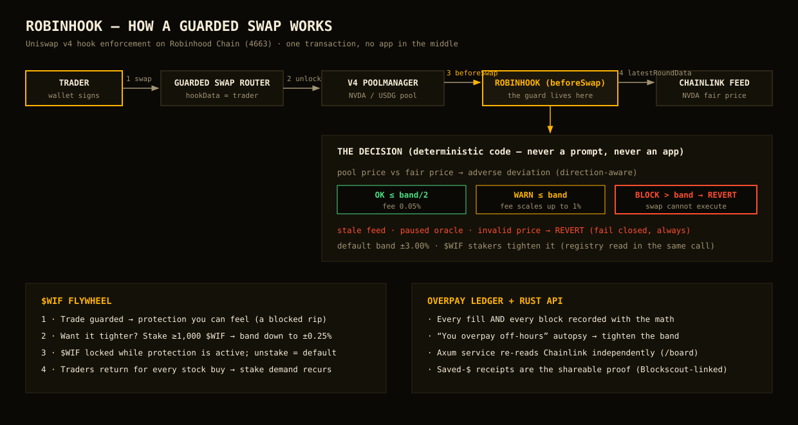

# RobinHook — never overpay for stocks

**Live app:** https://wif-indol.vercel.app · **Chain:** Robinhood Chain (4663) · **Hackathon:** World Is Flat — Hooks and DeFi + Stock Tokens · submissions close Nov 2 2026, 17:30 UTC

> The stock market went 24/7 onchain. Brokerage guardrails didn't come with it. RobinHook is a Uniswap v4 hook that stands *inside* your swap: it reads the Chainlink fair price mid-transaction and **reverts the trade if you would overpay**. Dashboards warn. Pools enforce.



---

## 1. Product

### What it is

RobinHook ports the [FairBuy](https://github.com/PhiBao/fairbuy) execution-safety thesis ("never overpay for tokenized stocks") from Solana — where the guard could only live in an app — to the first place it can live **in the market itself**: a Uniswap v4 `beforeSwap` hook on Robinhood Chain, where every Stock Token ships with a Chainlink fair-price feed a hook can read atomically.

For every swap in a guarded pool the hook computes the direction-aware adverse deviation between pool price and Chainlink fair value:

| Tier | Condition | Result |
|---|---|---|
| **OK** | adverse ≤ band/2 | swap executes, 0.05% LP fee |
| **WARN** | adverse ≤ band | swap executes, fee scales with deviation (cap 1%) |
| **BLOCK** | adverse > band | **swap reverts** (`OverpayBlocked`) — it cannot execute |
| **FAIL-CLOSED** | stale feed, paused oracle, invalid price | **swap reverts** — the guard never guesses |

Default band: ±3.00%. Stake ≥1,000 $WIF to set a tighter personal band (down to ±0.25%); the hook reads your stake in the same transaction.

### Who it is for

Robinhood Chain traders buying Stock Tokens (NVDA first) in thin 24/7 books while the underlying market sleeps — plus $WIF holders who want stricter-than-default protection.

### The problem (evidence)

- Tokenized stocks have printed wild dislocations: AAPLX traded at **+12% premium** within hours of launch (CryptoRank, Jul 2025). FairBuy's Solana research found pre-IPO tokens at **+53%/+29% over issuer marks**, invisible in every wallet.
- Robinhood Chain recreates the exact conditions: secondary trading is 24/7, Chainlink equity feeds are 24/5, mint/burn windows close on weekends. The gap between "reference price" and "tradable price" is structural to the category (Chainlink's own tokenized-equity docs describe it).
- Existing products display prices or execute blindly. Nobody enforces at execution time — because on most chains, they can't. On Robinhood Chain + Uniswap v4, they can.

### Why now

Uniswap v2/v3/**v4** live on Robinhood Chain since Jul 2026; ~190 Stock Tokens are ERC-20s with per-asset Chainlink `AggregatorV3Interface` feeds (multiplier-adjusted total-return prices, ERC-8056); $WIF needs real utility. The hook is the only form factor where protection cannot be bypassed by closing an app, switching frontends, or fat-fingering through a warning.

### The $WIF flywheel (load-bearing, not decorative)

1. Guarded trading is free at the default band — anyone can feel a blocked rip.
2. Tighter protection requires staking **$WIF** (World is Flat, `0x5173…4773`): stake ≥1,000 WIF → set band 25–300 bps in `WifBandRegistry`.
3. The hook enforces the staked band atomically (`hookData` carries the trader; the registry can only ever *tighten* vs default — by construction).
4. Every stock purchase routes traders back to their stake, band, and Overpay Ledger → recurring $WIF lock-up demand from recurring trading.

No new token. No rewards emissions. No custody.

---

## 2. User experience

1. **Board (no wallet needed):** three numbers per stock — market (DEX), fair (Chainlink), premium — live. This alone tells you if you'd overpay right now.
2. **Activation moment:** first swap attempted on a dislocated pool → **BLOCKED stamp + "you just saved ~$X"** in the Overpay Ledger.
3. **Primary workflow:** connect wallet (Robinhood Chain) → buy/sell NVDA in the guarded pool → hook verdict (OK/WARN/BLOCK) renders *before* you sign, from the same `previewGuard` math the hook enforces → sign → Blockscout receipt.
4. **Retention loop:** Overpay Ledger records fills *and* blocks with regime context ("you overpay off-hours") → autopsy nudges you to tighten your band → stake $WIF → tighter guard → shareable saved-$ receipts.

Design: high-vis amber on near-black, departure-board numerals (IBM Plex Mono), hazard stripe only at the guard moment, BLOCK rendered as a rotated stamp. Deliberately not a dashboard: one board, one guard card, one stake card, one ledger. Favicon is a deliberate mark (amber tile, price-line + hook), not a framework default.

---

## 3. Innovation

Fair-price protection used to require trusting an app to warn you before you signed elsewhere (FairBuy on Solana did exactly this, offchain). RobinHook moves the check **inside execution**:

- `beforeSwap` reads Chainlink, computes adverse deviation from the live pool sqrt price, and the swap either executes in-band at a fair fee, pays a deviation-scaled WARN fee, or **cannot execute at all**.
- Staleness follows equity reality: stock feeds are 24/5, so `maxStale` is 4 days (long weekend), and the ERC-8056 `oraclePaused()` corporate-action flag is honored as "price unavailable" — per Robinhood's own integration guidance.
- One-time pool configuration: after `configurePool`, the feed for a pool can never be changed. There is no admin path that can weaken a live guarded pool.

What becomes possible: execution safety as a property of the *pool*, inherited by every frontend, bot, or agent that routes through it.

---

## 4. Architecture

```
contracts/ (Foundry, Solidity — EVM hooks must be Solidity; see note)
  src/RobinHook.sol          IHooks.beforeSwap guard (OK/WARN/BLOCK + fail-closed)
  src/WifBandRegistry.sol    stake $WIF -> tighter personal band (tighten-only)
  src/GuardedSwapRouter.sol  exact-input swaps + liquidity, hookData = trader
  src/mocks/                 test-only mock tokens/feeds
  test/RobinHook.t.sol       9 unit tests vs local PoolManager
  test/fork/                 3 tests vs LIVE Robinhood mainnet state
  script/DeployCore.s.sol    CREATE2-mined hook deploy (beforeSwap flag 0x80)
  script/CreateGuardedPool.s.sol  configure + initialise + seed a pool

src/ (Next.js 15 + wagmi/viem, TypeScript)
  app/                       board + guard card + stake + ledger (single page)
  lib/contracts.ts           verified mainnet addresses + ABIs
  lib/ledger.ts              Overpay Ledger (localStorage + API mirror)

services/api/ (Rust, Axum — AGENTS.md default backend)
  GET /board                 independent Chainlink/premium read via raw eth_call
  POST /ledger, GET /ledger/:wallet, GET /stats, GET /health
  Ledger persists as append-only JSONL audit file.
```

**Backend language note (AGENTS.md §9):** offchain services are Rust as required. Onchain hook/registry/router are Solidity because Uniswap v4 hooks are EVM contracts — the exception is isolated to `contracts/` and justified by the protocol itself.

**Verified addresses (Robinhood Chain 4663):** PoolManager `0x8366…0951` · StateView `0xf333…673b` · NVDA `0xd060…9EEC` / feed `0x379E…9F15` · AAPL `0xaF3D…93f9` / feed `0x6B22…2cD0` · TSLA `0x322F…3b2d` / feed `0x4A11…7C38` · USDG `0x5fc5…d168` (6dp) · WETH `0x0Bd7…AD73` · $WIF `0x5173…4773` ("World is Flat").

---

## 5. Run it

### Frontend
```bash
pnpm install
pnpm dev            # http://localhost:3000  (board is live immediately)
pnpm build
```
Copy `.env.example` → `.env.local` and fill deployed contract addresses to enable guarded swaps + staking.

### Contracts
```bash
cd contracts
forge build
forge test                                   # 9 unit tests
forge test --match-contract RobinHookFork \
  --fork-url https://rpc.mainnet.chain.robinhood.com -vv   # 3 live-fork tests
```

### Rust API
```bash
cd services/api
cargo run --release  # :8787 — /health /board /ledger /stats
```

### Deploy (after funding the deployer with ETH gas on 4663)
```bash
cd contracts
forge script script/DeployCore.s.sol --rpc-url https://rpc.mainnet.chain.robinhood.com \
  --broadcast --private-key $PRIVATE_KEY
# then CreateGuardedPool.s.sol with STOCK/FEED/QUOTE/INIT_TICK env (see script header)
forge verify-contract <addr> src/RobinHook.sol:RobinHook --chain-id 4663 \
  --verifier blockscout --verifier-url https://robinhoodchain.blockscout.com/api/
```

---

## 6. Demo (180 seconds)

| Time | Beat |
|---|---|
| 0:00 | "This NVDA buy can overpay double digits off-hours — and every app will let you click it." |
| 0:20 | Board: market vs Chainlink fair vs premium, live. |
| 0:45 | Guard card: verdict renders from `previewGuard` — OK/WARN/BLOCK with the exact math. |
| 1:15 | **Attempt the bad swap → hook blocks it; "saved ~$X" lands in the Overpay Ledger.** |
| 1:45 | In-band swap executes under guard → Blockscout receipt. |
| 2:15 | Stake $WIF → tighten band to 1% → a previously-OK trade now blocks. |
| 2:40 | Ledger autopsy: blocks cluster off-hours. "Dashboards warn. Pools enforce." |
| 3:00 | Proof panel: every contract verifiable on Blockscout. |

Try it yourself first: open the live app, read the board (no wallet needed), then connect and check your verdict on NVDA.

---

## 7. Verification — what is real vs pending

**Real and verified (Oct 30 2026):**
- Hook, registry, router compile and pass **9 unit tests** (tiers, stale fail-closed, oracle-pause, stake-tightened band, router enforcement) — `contracts/test/RobinHook.t.sol:1`.
- **3 mainnet-fork tests pass against live Robinhood Chain state**: real Chainlink NVDA feed reads through the hook ($202.11 at test time), pool priced from the live v3 tick shows 26bps adverse (not blocked), pool config is one-time-write — `contracts/test/fork/RobinHookFork.t.sol:1`.
- Frontend live at https://wif-indol.vercel.app — board reads live Chainlink feeds + live Uniswap v3 NVDA/USDG every 20s.
- Rust API runs and serves live `/board` (NVDA fair $202.11, premium −8bps at verification time), `/ledger`, `/stats`.

**Pending deployment funding (honest status):**
- Guarded swap + $WIF staking activate when the deployer (`0xdb67c891045291FdA3835607dCCc2d5e89930bbc`, key held locally, never committed) is funded with gas ETH + seeding USDG/NVDA on 4663 and `DeployCore` + `CreateGuardedPool` are broadcast. The UI shows "GUARD DEPLOYMENT PENDING" until `NEXT_PUBLIC_ROBINHOOK/REGISTRY/ROUTER` are set — it never simulates a swap.
- Demo video and final mainnet tx pack are produced at that point (deadline Nov 2, 17:30 UTC).

**Mocked (clearly labeled):** local unit tests use mock tokens/feeds (`contracts/src/mocks/`, test-only). Nothing mocked is presented as mainnet behavior.

---

## 8. Security model

- **No custody:** router settles in the unlock callback and sweeps residuals to the caller in the same tx; registry holds only voluntarily staked WIF, withdrawable anytime.
- **No admin weakening:** pool config is one-time-write; stake bands can only tighten vs default (enforced in `WifBandRegistry.setBand` and hook default fallback).
- **Fail-closed oracle handling:** non-positive answer, incomplete round, stale (>4d for 24/5 equity feeds), or `oraclePaused()` → revert. No swap ever executes on a guessed price.
- **Direction-aware math:** adverse deviation only (buying above fair / selling below fair); favorable dislocations are never blocked.
- **Hook surface:** single permission (`beforeSwap`, address flag `0x80`), no delta-taking, no upgrade keys, hook address CREATE2-mined and verified against the mined salt in-script.
- **Known risks:** thin self-seeded pool can be pushed around — manipulation only ever *causes blocks* (fail-safe direction), never forces bad fills through; Chainlink feed trust is inherited from Robinhood Chain itself; stock-token jurisdictional restrictions apply to users (see below).

## 9. Limitations and roadmap

- Guarded pools protect trades routed *through them* (true of all v4 hooks); one seeded NVDA/USDG pool at launch.
- WARN fees accrue to LPs (standard v4 dynamic-fee semantics); a fee-funded $WIF buy-and-burn is roadmap, not claimed.
- Fair-Limit resting orders (hook limit orders at the fair price) and TWAP-at-fair are the designed next hooks; more stock tokens (AAPL/SPY pools) follow liquidity.
- The ledger is local-first; the Rust API mirror is the audit trail, not a source of truth for enforcement (enforcement needs no server at all — deliberately).

## 10. Hackathon relevance

- **Categories:** Hooks and DeFi (Uniswap v4 hook, dynamic fees, guarded pool) + Stock Tokens (Chainlink-priced Robinhood Stock Tokens), with $WIF utility in Consumer terms.
- **$WIF onchain (rule 3):** staking, band enforcement reads, and guarded trading all execute on Robinhood Chain mainnet against the canonical $WIF contract.
- **Flywheel (rule 7):** recurring guarded trading → recurring reason to hold/stake $WIF → tighter protection → more guarded trading.
- **Compliance:** Stock Tokens are not available in restricted jurisdictions (including the US) per Robinhood's list — the app carries this notice; nothing here is financial advice. Project naming follows Robinhood brand guidelines (no Robinhood marks in the logo; "RobinHook" is a hook pun, chain referenced descriptively).

*FairBuy proved people overpay invisibly. RobinHook makes the market itself stop them.*
